# Thiết kế database VIEJOB AI

**Làm sạch dữ liệu ngày 25/11/2026:** theo yêu cầu người dùng, đã xóa dữ liệu nghiệp vụ để nhập lại và thử AI, chỉ giữ 8 tài khoản cùng lịch sử migration. Các file sao lưu cũ đã xóa. Danh mục code được chuẩn hóa tên, không còn cần ánh xạ dữ liệu database cũ. Cấu trúc vẫn 27 bảng; xem cập nhật mới nhất trong [báo cáo danh mục](cac-thay-doi-danh-muc-co-dinh.md). Các nội dung bảo toàn dữ liệu/backup bên dưới mô tả đợt chuyển đổi trước lần làm sạch này.

**Cập nhật ngày 25/11/2026: 19 bảng nghiệp vụ + 8 bảng hạ tầng = 27 bảng.** Theo yêu cầu mới, bỏ quản lý danh mục Admin và 6 bảng `industries`, `job_categories`, `job_specializations`, `skills`, `job_levels`, `job_positions`. Các lựa chọn chuyển sang `config/job-catalog.php`; `App\Support\JobCatalog` đọc danh sách này.

### Cập nhật địa chỉ ngày 26/11/2026

Đã áp dụng migration `2026_11_26_100000_add_administrative_address_codes` theo phê duyệt. Tổng số bảng vẫn **27**.

| Cột bổ sung | Kiểu dữ liệu | Cho phép NULL | Ý nghĩa |
| --- | --- | --- | --- |
| `companies.province_code` | VARCHAR(2) | Có | Mã tỉnh/thành của doanh nghiệp tại Việt Nam |
| `companies.ward_code` | VARCHAR(5) | Có | Mã xã/phường/đặc khu của doanh nghiệp |
| `job_versions.ward_code` | VARCHAR(5) | Có | Mã xã/phường/đặc khu của phiên bản tin |

- `job_versions.province_code` VARCHAR(2) nullable đã tồn tại, không tạo lại. Ba cột mới không có PK, FK, UNIQUE, CHECK hoặc index bổ sung; mã lưu dạng chuỗi để giữ số 0 đầu.
- Danh mục tỉnh/xã nằm trong `resources/data/vietnam-administrative-address.json`, không có bảng hành chính. Backend kiểm tra mã hợp lệ và xã thuộc đúng tỉnh qua `VietnamAddress`.
- `companies.address` VARCHAR(255) và `job_versions.location` VARCHAR(150) giữ nguyên kiểu dữ liệu, dùng lưu **số nhà, tên đường**. Tên xã/tỉnh chỉ ghép khi hiển thị qua `full_address`/`full_location`, không ghi ngược chuỗi ghép vào database.
- Doanh nghiệp tại Việt Nam bắt buộc chọn tỉnh/xã khi lưu; quốc gia khác nhập địa chỉ tự do và hai mã để NULL. Tin nháp được phép thiếu mã; gửi duyệt cần đủ tỉnh/xã. Pending cũ thiếu mã xã được giữ tương thích, không sửa nội dung lịch sử.
- Địa chỉ cũ thiếu mã được giữ nguyên, không suy đoán xã, không backfill phiên bản đã duyệt. Không thêm quan hệ Eloquent tới danh mục tỉnh/xã; dùng helper đọc JSON.
- Không đổi published pointer, kết quả AI, FK hiện hữu hoặc cơ chế phiên bản. Migration rollback từ chối bỏ cột nếu còn dữ liệu mã địa chỉ.
- Cập nhật ô lương chỉ thuộc giao diện; `salary_min`/`salary_max` vẫn DECIMAL(15,2), không thêm hoặc đổi cột.

Chi tiết nguồn danh mục và giới hạn đối chiếu cấp xã: [báo cáo địa chỉ](vietnam-administrative-address-implementation.md).

### Quyết định hiện hành về danh mục cố định

- Giữ nguyên mã lựa chọn đã lưu. Các cột `companies.industry_id`, `job_versions.industry_id/job_specialization_id/job_level_id/job_position_id`, `job_version_skills.skill_id`, `resume_skills.skill_id` là **mã trong code**, không còn FK tới bảng danh mục. Kiểu dữ liệu, NULL, index và UNIQUE còn lại giữ nguyên.
- Bỏ 8 FK tới danh mục (gồm FK nội bộ chuyên môn → nhóm nghề), không thay FK JobVersion, CV revision, ứng tuyển hoặc published pointer.
- Lĩnh vực, vị trí, chuyên môn, cấp bậc và kỹ năng được kiểm tra tại backend bằng danh sách cố định. Nhóm nghề suy ra từ chuyên môn. Không có API thêm/sửa/ẩn danh mục.
- Quan hệ Eloquent tới bảng danh mục được thay bằng accessor chỉ đọc. `JobVersion::skillRequirements()` và `Resume::skills()` vẫn là quan hệ với bảng nghiệp vụ. `JobVersion::$skills` trả danh sách tên/mã từ code cùng pivot đã lưu.
- Không đổi/tái sử dụng mã, không chuyển nhóm chuyên môn đã dùng; muốn bổ sung thì thêm mã mới. Ghi SQL trực tiếp phải tuân thủ danh sách này vì không còn FK kiểm tra mã danh mục.
- Migration chuyển đổi kiểm tra tên/mã/nhóm cũ, sao lưu JSON gồm DDL và các dòng danh mục vào private storage trước khi bỏ bảng. Không tự rollback; phục hồi cần đối chiếu cả lựa chọn mới đã được sử dụng.
- Tài liệu khảo sát và quyết định cũ bên dưới là lịch sử theo thời điểm. Mục này và ERD hiện hành thay thế các quy định cũ về CRUD, trạng thái danh mục và FK tới 6 bảng đã bỏ. Xem [báo cáo thay đổi](cac-thay-doi-danh-muc-co-dinh.md).

## 1. Kết quả phân tích hiện trạng

### 1.1 Môi trường và cách kiểm tra

| Hạng mục | Bằng chứng |
| --- | --- |
| Laravel/PHP | composer.json yêu cầu Laravel ^12.0, PHP ^8.2; composer.lock và runtime Laravel **12.70.2**, PHP CLI **8.2.0** |
| Kết nối | .env DB_CONNECTION=mysql, DB_DATABASE=db_job; runtime xác nhận mysql; không có bootstrap/cache/config.php |
| Máy chủ | **11.5.2-MariaDB**, không phải Oracle MySQL; các bảng thực tế InnoDB, utf8mb4_unicode_ci |
| config/database.php | Có mysql/mariadb/sqlite; MySQL strict=true, engine=null, charset utf8mb4; không tự sửa |
| Queue/session/cache | .env đều dùng database; config/queue.php đang dùng bảng `jobs`, after_commit=false |
| SQLite cũ | database/database.sqlite vẫn tồn tại, 9 bảng nền; sessions 11 dòng, migrations 3, các bảng còn lại 0; không phải kết nối mặc định |
| Model | Chỉ có User; fillable name/email/password, password cast hashed, chưa quan hệ nghiệp vụ |
| Seeder/Factory | DatabaseSeeder tạo Test User; UserFactory dùng mật khẩu cố định phục vụ test; không chạy vào production, không tạo Admin mặc định |
| AI | Chỉ tìm thấy semantic_matching_test.py: all-MiniLM-L6-v2 + cosine_similarity trên chuỗi mẫu. Chưa tìm thấy FastAPI app/router, requirements/pyproject, HTTP AI client, worker PDF hoặc kho embedding trong repository ứng dụng |

Đọc DB bằng bootstrap console, SHOW FULL TABLES, SHOW CREATE TABLE, SELECT COUNT(*) và tên migration trong **transaction READ ONLY**, kết thúc rollback. Không đọc payload session/cache, mật khẩu, token. Số dòng là ảnh chụp tại lúc khảo sát, có thể thay đổi do website hoạt động. Không chạy Python AI để tránh tải mô hình; không chạy test có thể ghi database.

### 1.2 Các bảng thực tế

| Bảng | Số dòng | Cột/khóa hiện có | Hướng xử lý |
| --- | ---: | --- | --- |
| users | 0 | id BIGINT UNSIGNED PK AUTO_INCREMENT; name/email/password VARCHAR(255); email UNIQUE; email_verified_at TIMESTAMP NULL; remember_token VARCHAR(100) NULL; created_at/updated_at TIMESTAMP NULL | Bổ sung role/status/last_login_at |
| password_reset_tokens | 0 | email VARCHAR(255) PK; token VARCHAR(255); created_at TIMESTAMP NULL | Giữ, dùng Laravel password broker |
| sessions | 2 | id VARCHAR(255) PK; user_id BIGINT UNSIGNED NULL INDEX (chưa FK); ip_address VARCHAR(45) NULL; user_agent TEXT NULL; payload LONGTEXT; last_activity INT INDEX | Giữ; thêm FK user_id sau audit orphan |
| cache | 2 | key VARCHAR(255) PK; value MEDIUMTEXT; expiration INT | Giữ |
| cache_locks | 0 | key VARCHAR(255) PK; owner VARCHAR(255); expiration INT | Giữ |
| jobs | 0 | id BIGINT UNSIGNED PK AI; queue VARCHAR(255) INDEX; payload LONGTEXT; attempts TINYINT UNSIGNED; reserved_at INT UNSIGNED NULL; available_at/created_at INT UNSIGNED | **Bảng queue**, đề xuất rename queue_jobs, không drop |
| job_batches | 0 | id VARCHAR(255) PK; name VARCHAR(255); total_jobs/pending_jobs/failed_jobs INT; failed_job_ids LONGTEXT; options MEDIUMTEXT NULL; cancelled_at/finished_at INT NULL; created_at INT | Giữ |
| failed_jobs | 0 | id BIGINT UNSIGNED PK AI; uuid VARCHAR(255) UNIQUE; connection/queue TEXT; payload/exception LONGTEXT; failed_at TIMESTAMP DEFAULT CURRENT_TIMESTAMP | Giữ |
| migrations | 3 | id INT UNSIGNED PK AI; migration VARCHAR(255); batch INT | Giữ lịch sử |

Đã chạy batch 1: `0001_01_01_000000_create_users_table`, `0001_01_01_000001_create_cache_table`, `0001_01_01_000002_create_jobs_table`. Không sửa các migration đã chạy. Chưa có bảng nghiệp vụ doanh nghiệp, CV, ứng tuyển, danh mục hoặc AI.

### 1.3 Đối chiếu mã nguồn

| Nguồn | Phát hiện và ảnh hưởng thiết kế |
| --- | --- |
| routes/web.php, CandidatePageController, CandidateDemoController, CandidateDemo | CV, saved, applications, notifications dùng session; authPreview chỉ validate, chưa xác thực thật. CandidateDemo::apply lưu tên CV, **chưa copy snapshot PDF** |
| CandidateProfileRequest, ca_pages/profile.blade.php | name, email, phone, location, profession, experience(text), bio, avatar; không có ngày sinh/lương mong muốn |
| ResumeUploadRequest, resume-card.blade.php | PDF ≤5120 KiB, tối đa 10 CV; chọn chính/đổi tên/thay/xóa; đã bỏ xác nhận kỹ năng; nạp kết quả mẫu cho completed |
| CandidateCatalog | publicJobs kiểm tra approved/open/deadline/company/recruiter; filters industry/company/group/specialty/skill/level/location/mode/type/experience/salary; recommendations dùng điểm giả theo id |
| routes/recruiter.php, RecruiterPageController, recruiter.js/domain/views | dữ liệu sessionStorage; hoạt động tách kiểm duyệt, application notes/history; quyền hiện tại chưa phải Policy thật |
| employer/job-form.blade.php, RecruiterCatalog | title, position, description, requirements, benefits, salary_min/max (triệu/tháng), location, quantity, experience(text), mode Onsite/Remote/Hybrid, type, deadline, occupationId/specialtyId, skills(text) |
| CompanyProfiles, SaveCompanyRequest, company-form.blade.php | summary, size, industry(text), ot_policy, technologies(text), logo/cover/office; session owner_token. Phải map sang user ownership, không dùng token phiên làm quyền thật |
| routes/admin.php, AdminCatalog, admin-domain/categories*.js | 5 danh mục; nhóm–chuyên môn 1–N; ẩn/hiện; khóa/mở khóa; phiên bản demo; rule hiện còn ở JS |
| public/recruiter/js/recruiter-ai.js | Điểm demo round(0.6 semantic + 0.4 skill), retry, version mẫu; không có kết quả AI thật để import |
| app/Models/User.php, bootstrap/app.php | Chưa có Model nghiệp vụ, auth/role middleware, Policy, queue Job hoặc Notification class nghiệp vụ |
| Candidate ca_pages/messages.blade.php | Trang trống “chưa kết nối”; không tự thêm chat tables |

Đã đọc Controller, Service, Form Request, catalogs, ba nhóm route, form Blade và JS nghiệp vụ liên quan dữ liệu; không coi thư viện template/minified là quy tắc nghiệp vụ. Không giả định giao diện demo đã bảo đảm quyền/concurrency.

## 2. Khác biệt và quyết định đã chốt

1. Môi trường chính thức đã được người dùng chốt: **MariaDB 11.5.2, InnoDB, utf8mb4, PHP 8.2.0, Laravel 12, Apache trên Windows**. Giữ collation utf8mb4_unicode_ci hiện có, ngoại lệ normalized_name/JSON dùng utf8mb4_bin. Không chuyển sang Oracle MySQL; DB_CONNECTION=mysql hiện tại là kết nối PDO tương thích MariaDB, chưa đổi cấu hình.
2. Rename queue jobs→queue_jobs bằng migration mới có preflight, rồi mới tạo jobs tuyển dụng. Không sửa migration gốc, không xóa hàng queue.
3. Giữ PK BIGINT của users. Company/resume/application thêm public_id UUID để tương thích đường dẫn demo UUID; FK nội bộ BIGINT. 5 danh mục có code NN-/CM-/LV-/KN-/CB- để adapter giữ UI.
4. Không import sessionStorage/session demo tự động: ba vai trò có dữ liệu mẫu độc lập, cùng id không có nghĩa cùng thực thể thật.
5. Industries và job_categories là hai khái niệm riêng. Specialty thuộc một group. Đã chốt **không chuyển nhóm chuyên môn đã được version tin tham chiếu** để không đổi phân loại lịch sử; nếu cần tạo mục mới và ẩn cũ. Service phải chặn cả API cập nhật trực tiếp và thao tác đồng thời với tạo phiên bản tin.
6. Company industry hiện là text “Công nghệ thông tin”, không khớp 5 lĩnh vực. Giữ FK industry_id nullable của doanh nghiệp + mapping có người kiểm tra; không tự đoán. Recruiter job form chưa có industry/level nhưng Candidate có filter: hai FK nullable ở draft, bắt buộc khi submit; đã chốt quy tắc này; nối input ở giai đoạn triển khai, chưa sửa UI.
7. Hạn tuyển nằm ở job_versions.application_deadline; jobs.expires_at là cache bản công khai, cập nhật cùng published pointer. Không cho deadline nháp làm hết hạn bản đang công khai.
8. Thêm resume_revisions để lưu nguồn file/hash/phân tích theo phiên bản; tránh worker cũ ghi đè PDF mới. Không thêm xác nhận kỹ năng, embedding table hoặc hệ AI thứ hai.
9. User/company dùng locked ở DB, blocked ở UI qua adapter; jobs vẫn blocked. CV needs_review demo cũ chỉ chuyển completed nếu đã có kết quả hợp lệ, không tái tạo xác nhận.
10. Giữ 6 nhãn cấp bậc đang có, không tự thay “Có kinh nghiệm” thành Junior/Senior. Không thêm ngày sinh, thông tin nhạy cảm, chat, tài khoản trả phí. Không tạo skill_aliases trong MVP: AI Service quản lý từ điển đồng nghĩa có phiên bản, ánh xạ về skills.id; không thêm UI Admin cho alias.

## 3. Quy ước từ điển dữ liệu

- `ID`: BIGINT UNSIGNED AUTO_INCREMENT PRIMARY KEY; các *_id là BIGINT UNSIGNED trừ nơi ghi khác. FK mặc định ON DELETE RESTRICT, ON UPDATE RESTRICT. Không cascade lịch sử.
- `TS`: created_at và updated_at DATETIME(6) NOT NULL ghi UTC. `?`: nullable, lý do tại từng bảng; không ? là NOT NULL. Lịch sử chỉ có created_at.
- `V(n)`: VARCHAR(n); U32/U16/U8: INT/SMALLINT/TINYINT UNSIGNED. BOOL: TINYINT(1) CHECK IN(0,1). UUID: CHAR(36) ASCII binary. SHA-256: CHAR(64) ASCII binary.
- Trạng thái VARCHAR + CHECK và PHP enum dự kiến. Lương DECIMAL(15,2), điểm DECIMAL(5,2) 0..100, confidence DECIMAL(5,4) 0..1. Không FLOAT.
- Tên chuẩn hóa normalized_name V(120), utf8mb4_bin: NFKC, trim, gộp whitespace, lowercase(vi); giữ dấu và C++/C#. Service thực hiện chuẩn hóa, unique index enforce giá trị đã chuẩn hóa. Slug V(160), unique, suffix khi va chạm, không tự đổi khi đổi tên.
- Mỗi FK có index; composite đã phủ prefix thì không tạo index đơn thừa. Không mặc định NULL thành chuỗi rỗng.
- JSON dùng cho kết quả AI, snapshot audit và danh sách ảnh văn phòng giới hạn; liên kết danh mục dùng FK/pivot. Đường dẫn file private V(255), không binary PDF/ảnh trong DB.
- Password dùng Laravel Hash, reset token hash. **remember_token mặc định Laravel không hash**: giữ cột legacy nullable, đã chốt tạm tắt remember-me trong MVP; nếu cần phải duyệt hashed-token/guard trước, không lưu token thô mới. Session id opaque theo framework, payload không chứa credential AI. Không in secret vào tài liệu/log.

## 4. Từ điển bảng đích

### 4.1 users — điều chỉnh

Giữ `id ID`, `name/email/password V(255)`, `email_verified_at TIMESTAMP?`, `remember_token V(100)?`, created_at/updated_at TIMESTAMP? hiện có. Thêm `role V(20)`, `status V(20) DEFAULT 'active'`, `last_login_at DATETIME(6)?` (chưa đăng nhập).

Bổ sung Google OAuth đã được phê duyệt ngày 16/11/2026: `google_subject VARCHAR(255) CHARACTER SET ascii COLLATE ascii_bin NULL`, UNIQUE `users_google_subject_unique`. Lưu sub ổn định do Google xác minh, không dùng email làm identity; một Google account liên kết tối đa một User. Nhiều User có NULL được phép. Không thêm bảng, vẫn 24 nghiệp vụ + 8 hạ tầng. Không backfill/liên kết tự động theo email. Model ẩn google_subject và không mass assign; Service gán explicit. Password vẫn NOT NULL: đăng ký Google mới dùng hash chuỗi ngẫu nhiên mật mã, không có mật khẩu mặc định được công bố. Không lưu OAuth token/code vào schema. Liên kết tài khoản cũ phải xác nhận mật khẩu và hoàn tất Google state trong cùng phiên.

Bổ sung Giai đoạn 2.2 đã được phê duyệt: `has_local_password TINYINT(1) NULL DEFAULT NULL`, CHECK `users_has_local_password_check` giới hạn NULL/0/1. True: đã biết có mật khẩu người dùng; false: Google-only được xác định từ luồng đăng ký mới; NULL: chưa đủ nguồn gốc. Không index/FK/bảng mới; không fillable, cast boolean giữ NULL. Backfill tài khoản không Google thành true, tài khoản có Google cũ giữ NULL. Đăng ký email/Admin=true, Google mới=false; login Google/link không đổi cờ. Email login thành công, đổi/reset/setup mật khẩu cập nhật true; không suy đoán từ hash/email/Google subject. Google re-auth setup chỉ dành cho false + active + subject; true/NULL không được bỏ qua mật khẩu cũ. Rollback cột bị chặn khi tồn tại User để bảo toàn phân loại.

UNIQUE(email); INDEX(role,status,id). CHECK role candidate/recruiter/admin; status active/locked. User cũ: thêm role nullable, mapping/backfill có kiểm tra rồi NOT NULL; không tự gán vai trò. Không hard delete tài khoản có nghiệp vụ. Role phù hợp với company/profile kiểm tra Service, FK không kiểm tra role.

### 4.2 candidate_profiles — mới

`id ID`, `user_id`, `phone V(20)?`, `location V(100)?`, `professional_title V(100)?`, `experience_summary V(100)?`, `summary TEXT?` (≤1500), `avatar_path V(255)?`, `recommendation_generation U32 DEFAULT 0`, TS.

FK user_id→users.id; UNIQUE(user_id). Các ? là input không bắt buộc. Không lưu lặp name/email, lấy users. Không ép kinh nghiệm tự do thành years_of_experience. Generation tăng khi đổi CV chính hoặc thay/xóa/reparse CV chính, để invalidation kết quả cũ.

### 4.3 companies — mới

`id ID`, `public_id UUID`, `recruiter_id`, `name V(150)`, `slug V(160)`, `logo_path V(255)?`, `office_images JSON`, `description TEXT?` (≤10000), `company_size V(30)?`, `industry_id?`, `company_type V(80)?`, `country V(80)?`, `website V(255)?`, `email V(150)`, `phone V(30)`, `address V(255)`, `province_code V(2)?`, `ward_code V(5)?`, `working_hours V(255)?`, `overtime_policy TEXT?` (≤2000), `work_environment TEXT?` (≤3000), `status V(20) DEFAULT 'active'`, TS.

UNIQUE(public_id), UNIQUE(slug), UNIQUE(recruiter_id). FK recruiter_id→users.id, industry_id→industries.id; INDEX(status,name,id). Các ? do form cho phép thiếu. CHECK status active/locked, work_environment NULL hoặc tối đa 3000 ký tự. Size giữ 6 khoảng nhân sự; mapping size→company_size, ot_policy→overtime_policy. Theo phê duyệt ngày 18/11/2026, migration `2026_11_18_120000_simplify_company_profile` bỏ short_name, short_description, founded_year, benefits, technologies, cover_image_path và CHECK liên quan, thêm work_environment. Không backfill bằng nội dung phúc lợi cũ. Địa chỉ nhập thủ công, không Google Maps. Public projection không xuất email/phone quản trị hoặc disk paths; website http(s) hoặc NULL khi không có website. Vẫn 32 bảng; sao lưu đầy đủ trước khi bỏ cột, không dùng down để khôi phục nội dung đã xóa.

Office_images NOT NULL, Service khởi tạo `[]`, không phụ thuộc SQL default biểu thức. JSON là mảng tối đa 6 object dạng `{"path":"companies/<public_id>/office/<uuid>.webp","caption":null}`; caption tùy chọn ≤255, path ≤255. **Thứ tự phần tử là thứ tự hiển thị**, không lưu sort_order riêng. CHECK JSON_VALID, JSON_TYPE='ARRAY', JSON_LENGTH≤6; Service kiểm tra object chỉ có path/caption, path không trùng, đúng namespace doanh nghiệp và file thuộc upload hợp lệ. Không nhận đường dẫn máy Windows, URL ngoài, `..`, tên file thực thi hoặc path của doanh nghiệp khác từ client. JSON không có FK tới file; đây là giới hạn được bù bằng validation và đối soát storage.

Chỉ owner Recruiter đang hoạt động được sửa. JPEG/PNG/WebP kiểm tra nội dung/MIME và giải mã ảnh, logo≤2MiB, mỗi ảnh văn phòng≤3MiB, kích thước≤5000×5000. File UUID lưu private ngoài webroot; endpoint ảnh công khai chỉ phục vụ file đã được company tham chiếu và company/recruiter còn active; owner/Admin xem theo Policy. Không trả disk path qua API công khai. Thay/xếp ảnh khóa company row, kiểm tra updated_at mà form đã đọc để từ chối ghi đè thay đổi mới; ghi cả mảng trong một transaction. Upload staging trước transaction; chỉ dọn file cũ sau commit và kiểm tra không còn tham chiếu. DB rollback không xóa file đang sử dụng. Không tạo company_images.

### 4.4 industries — mới

`id ID`, `code V(20)`, `name V(120)`, `normalized_name V(120)`, `slug V(160)`, `description TEXT?` (≤1000, chưa mô tả), `is_active BOOL DEFAULT 1`, `sort_order U16 DEFAULT 0`, TS.

UNIQUE(code), UNIQUE(normalized_name), UNIQUE(slug); INDEX(is_active,sort_order,id). Không gộp industries với nhóm nghề dù tên mẫu giống nhau.

### 4.5 job_categories — mới

Cột/khóa/index giống industries. Nguồn OccupationCatalog::occupations (7 nhóm). 1–N specializations; không ẩn nhóm còn chuyên môn active; Service khóa group row để serialize thao tác thêm/hiện/ẩn.

### 4.6 job_specializations — mới

`id ID`, `code V(20)`, `job_category_id`, `name V(120)`, `normalized_name V(120)`, `slug V(160)`, `description TEXT?` (≤1000), `is_active BOOL DEFAULT 1`, `sort_order U16 DEFAULT 0`, TS.

FK job_category_id→job_categories.id; UNIQUE(code), UNIQUE(job_category_id,normalized_name), UNIQUE(slug) toàn cục; INDEX(job_category_id,is_active,sort_order,id). Active specialty cần active group. Không chuyển group nếu đã có version tin tham chiếu (đã chốt); group của JD suy ra qua specialization, không lặp FK group trong JD.

### 4.7 skills — mới

`id ID`, `code V(20)`, `name V(120)`, `normalized_name V(120)`, `description TEXT?` (≤1000), `is_active BOOL DEFAULT 1`, `sort_order U16 DEFAULT 0`, TS. UNIQUE(code), UNIQUE(normalized_name); INDEX(is_active,sort_order,id). 36 mẫu từ JobCategoryCatalog. Ẩn không làm mất skill của JD/CV cũ; AI vẫn có thể nhận diện skill lịch sử, không cho chọn skill ẩn vào JD mới.

### 4.8 job_levels — mới

Cột/khóa/index giống industries. Giữ nhãn Thực tập sinh/Có kinh nghiệm/Mới tốt nghiệp/Trưởng nhóm/Quản lý/Giám đốc; Intern/Fresher/Junior/Middle/Senior trong đặc tả chỉ là ví dụ, không thay khi chưa chốt mapping.

### 4.9 jobs — mới sau rename queue

**Danh mục bổ sung `job_positions` (19/11/2026):** id BIGINT UNSIGNED PK; code VARCHAR(20) UNIQUE; name VARCHAR(120); normalized_name VARCHAR(120) COLLATE utf8mb4_bin UNIQUE; slug VARCHAR(160) UNIQUE; description TEXT NULL CHECK tối đa 1000 ký tự; is_active boolean CHECK 0/1 DEFAULT 1; sort_order SMALLINT UNSIGNED DEFAULT 0; created_at/updated_at DATETIME(6). INDEX(is_active,sort_order,id). Không xóa cứng; tái sử dụng dịch vụ danh mục Admin. Eloquent: JobPosition::jobVersions() hasMany, JobVersion::positionCatalog() belongsTo.

`job_versions.job_position_id` FK nullable tới job_positions (RESTRICT); `province_code` VARCHAR(2) nullable, index riêng từng cột. Backend kiểm tra danh sách 34 mã tỉnh/thành phố trong `Provinces::ALL`. Vị trí và tỉnh được yêu cầu khi gửi bản nháp mới; pending cũ thiếu cả hai trường vẫn được kiểm duyệt mà không sửa nội dung. Cột position mở rộng 120 ký tự, lưu tên vị trí tại thời điểm chọn; đổi tên danh mục không đổi nội dung phiên bản cũ. Kinh nghiệm giữ dữ liệu lịch sử nhưng bỏ khỏi form và yêu cầu gửi duyệt. Nhóm nghề suy ra từ chuyên môn, không nhận lựa chọn nhóm từ client. Không tạo bảng liên kết lĩnh vực.

`id ID`, `company_id`, `status V(20) DEFAULT 'draft'`, `status_before_block V(20)?`, `published_version_id?`, `published_at DATETIME(6)?`, `expires_at DATETIME(6)?`, TS.

FK company_id→companies.id; **composite FK(id,published_version_id)→job_versions(job_id,id)** thêm sau khi có cả hai bảng. CHECK status draft/open/paused/closed/blocked; status_before_block chỉ draft/open/paused/closed hoặc NULL, chỉ có khi blocked. Published pointer/date/cache nullable vì chưa công khai; CHECK pointer NULL thì published_at/expires_at NULL. Approved của version phải kiểm tra Service, FK không thể kiểm tra. INDEX(company_id,status,created_at,id), INDEX(status,published_at,id), INDEX(status,expires_at,id). Không có nội dung nháp trong jobs.

### 4.10 job_versions — mới

`id ID`, `job_id`, `version_number U32`, `title V(150)`, `position V(120)?`, `job_position_id?`, `province_code V(2)?`, `ward_code V(5)?`, `description TEXT?`, `requirements TEXT?`, `benefits TEXT?`, `salary_min DECIMAL(15,2)?`, `salary_max DECIMAL(15,2)?`, `salary_currency CHAR(3) DEFAULT 'VND'`, `salary_negotiable BOOL DEFAULT 0`, `location V(150)?`, `work_mode V(10)?`, `employment_type V(20)?`, `quantity U16?`, `experience_summary V(100)?`, `experience_min DECIMAL(4,1)?`, `experience_max DECIMAL(4,1)?`, `industry_id?`, `job_specialization_id?`, `job_level_id?`, `application_deadline DATE?`, `review_status V(20) DEFAULT 'draft'`, `submitted_at DATETIME(6)?`, `reviewed_at DATETIME(6)?`, `pending_slot U8 GENERATED STORED` = CASE WHEN review_status='pending' THEN 1 ELSE NULL END, TS.

FK job_position_id→job_positions.id (RESTRICT), INDEX(job_position_id), INDEX(province_code); job_id→jobs.id; industry_id→industries.id; job_specialization_id→job_specializations.id; job_level_id→job_levels.id. UNIQUE(job_id,version_number), UNIQUE(job_id,id), UNIQUE(job_id,pending_slot). INDEX(review_status,submitted_at,id), INDEX(job_specialization_id,id), INDEX(industry_id,id), INDEX(job_level_id,id), INDEX(location,work_mode,id). FK jobs.published_version_id dùng unique composite nói trên để chặn trỏ nhầm tin.

Theo phương án A được phê duyệt cho Giai đoạn 3.2, bản nháp chỉ bắt buộc title có nội dung, tối đa 150 ký tự. Đúng 13 cột đánh dấu `?` mới ở trên cho phép NULL: position, description, requirements, benefits, salary_min, salary_max, location, work_mode, employment_type, quantity, experience_summary, job_specialization_id, application_deadline. industry_id/job_level_id/experience_min/max đã nullable từ trước. Không điền dữ liệu giả để lấp chỗ trống.

CHECK version_number≥1; quantity NULL hoặc 1..1000; từng đầu lương NULL hoặc không âm, min≤max nếu đủ hai đầu; currency='VND'; experience_min/max≥0 nếu có và min≤max nếu đủ hai giá trị. work_mode NULL hoặc onsite/remote/hybrid; employment_type NULL hoặc full_time/part_time/internship. Review status draft/pending/approved/rejected. CHECK title không toàn khoảng trắng; khi review_status khác draft, 12 cột nội dung (không gồm experience_summary) phải NOT NULL, các trường văn bản bắt buộc có nội dung sau TRIM, industry_id/job_level_id/submitted_at phải NOT NULL. Dùng IS NOT NULL tường minh để SQL UNKNOWN không vượt ràng buộc. TEXT NULL hoặc tối đa 10000 ký tự. Service bổ sung kiểm tra danh mục đang hoạt động, chuyên môn đúng nhóm, ít nhất một kỹ năng và hạn tuyển không trước ngày gửi theo Asia/Ho_Chi_Minh. Experience range NULL khi text không parse chắc chắn, không đoán. submitted_at NULL trước gửi, reviewed_at NULL trước quyết định. Lưu VND/tháng bằng decimal, không FLOAT; form thật nhập VND. Salary_negotiable chưa có UI, default false.

Migration bổ sung: `2026_11_17_100000_allow_incomplete_job_drafts`. Giữ nguyên kiểu cột, PK/FK/UNIQUE, generated pending_slot và 32 bảng. Up kiểm tra dữ liệu trước DDL; down từ chối nếu còn NULL trong 13 cột. Rollback cần ngừng ghi vì MariaDB yêu cầu tháo rồi dựng lại nguyên định nghĩa FK chuyên môn khi chuyển về NOT NULL. Không tự xóa hay lấp dữ liệu để rollback. Xem biên bản backup/restore và diễn tập trong `backend-jobs-implementation.md`.

Nội dung/pivot/hạn của pending/approved bất biến. Sửa sau reject cũng tạo version mới; chỉ ModerationService đổi review_status và metadata duyệt. Draft hiện phải đủ trường form, chưa hỗ trợ autosave từng ô. Chỉ đề xuất FULLTEXT(title,description,requirements) sau benchmark tiếng Việt; MVP LIKE escaped, không hứa B-tree tăng tốc `%từ khóa%`.

### 4.11 job_version_skills — mới

`id ID`, `job_version_id`, `skill_id`, `is_required BOOL DEFAULT 1`, TS. FK version→job_versions.id, skill→skills.id; UNIQUE(job_version_id,skill_id); INDEX(skill_id,job_version_id). Không pivot trực tiếp jobs_skills. Input text skills cần map ids hoặc báo lỗi, không tự thêm danh mục thật từ chuỗi tự do.

### 4.12 job_moderation_logs — mới

`id ID`, `job_id`, `job_version_id`, `admin_id`, `action V(10)` approve/reject, `reason TEXT?` (≤2000), `created_at DATETIME(6)`. Composite FK(job_id,job_version_id)→job_versions(job_id,id); FK admin_id→users.id. UNIQUE(job_version_id) vì một version chỉ có một quyết định cuối; gửi lại sau reject tạo version mới. INDEX(job_id,created_at,id). CHECK reject có reason không rỗng; approve có thể NULL. Append-only, ghi cùng transaction cập nhật trạng thái/con trỏ công khai.

### 4.13 resumes — mới

`id ID`, `public_id UUID`, `candidate_id`, `display_name V(100)`, `current_revision U32`, `is_primary BOOL DEFAULT 0`, `deleted_at DATETIME(6)?`, `primary_slot U8 GENERATED STORED` = CASE WHEN is_primary=1 AND deleted_at IS NULL THEN 1 ELSE NULL END, TS.

FK candidate_id→users.id; UNIQUE(public_id), UNIQUE(id,candidate_id), UNIQUE(candidate_id,primary_slot); INDEX(candidate_id,deleted_at,id). CHECK current_revision≥1; deleted_at IS NULL OR is_primary=0. Deleted_at NULL là CV hoạt động. **Service tạo resume+revision 1 cùng transaction và bảo đảm current_revision có row tương ứng**; không thêm FK vòng resumes↔resume_revisions. File/parse nằm ở revision, không lặp trong resumes. Tối đa 10 và luôn có CV chính nếu còn CV do lock parent + Service thực thi; unique chỉ bảo đảm tối đa một.

### Bổ sung AI JobVersion được duyệt ngày 24/11/2026

Giai đoạn 3.6B giữ 33 bảng, bổ sung metadata tại job_versions: ai_analysis_result JSON nullable,
ai_analysis_status VARCHAR(20) nullable, ai_processing_token CHAR(36) nullable,
ai_attempt_count SMALLINT UNSIGNED DEFAULT 0; ai_started_at, ai_lease_expires_at,
ai_next_retry_at, ai_analyzed_at DATETIME(6) nullable; ai_model_version VARCHAR(100),
ai_error_code VARCHAR(60) nullable. CHECK trạng thái pending/processing/completed/failed hoặc NULL,
attempt_count <=3; completed phải có result/analyzed_at/model_version.
INDEX(ai_analysis_status, ai_next_retry_at, id). PK JobVersion xác định duy nhất kết quả;
không thêm FK/UNIQUE. Eloquent cast result=array, attempt_count=integer, các thời gian=datetime;
không thêm fillable. Worker chỉ cập nhật cột AI, giữ updated_at nghiệp vụ. Replicate V2 loại bỏ
metadata AI V1. Chi tiết: backend-ai-job-analysis-implementation.md.

### 4.14 resume_revisions — mới bổ sung có lý do

Bổ sung được duyệt và triển khai ngày 24/11/2026: `analysis_result JSON NULL`, lưu kết quả Ollama theo revision, cast Eloquent `array`. Không thêm bảng hoặc thay đổi khóa. JSON có schema_version và bảy nhóm thông tin kèm bằng chứng; xem `backend-ai-cv-analysis-implementation.md`. Token được cấp lúc enqueue, kiểm tra lại trước khi worker ghi kết quả.

`id ID`, `resume_id`, `revision U32`, `file_path V(255)`, `original_filename V(255)`, `file_size U32`, `mime_type V(100)`, `file_hash CHAR(64)`, `parsing_status V(20) DEFAULT 'pending'`, `extracted_text_path V(255)?`, `parser_version V(100)?`, `parsed_at DATETIME(6)?`, `error_code V(60)?`, `error_message V(1000)?`, `processing_token UUID?`, `attempt_count U16 DEFAULT 0`, `started_at DATETIME(6)?`, `lease_expires_at DATETIME(6)?`, `next_retry_at DATETIME(6)?`, TS.

FK resume_id→resumes.id; UNIQUE(resume_id,revision); INDEX(parsing_status,next_retry_at,id). CHECK revision≥1, file_size 1..5242880, mime_type='application/pdf', status pending/processing/completed/failed. Không UNIQUE hash vì nhiều người có thể cùng PDF. ? là metadata chưa có trước bước xử lý/lỗi; token/lease chỉ có khi claim tác vụ. Completed cần parsed_at và extracted_text_path. Scan không text→failed/no_extractable_text; không OCR. File/path/hash bất biến theo revision; retry sửa lifecycle metadata, không thay file. Giữ revision cũ để audit, current pointer chỉ đổi bởi upload/replacement Service.

### 4.15 resume_skills — mới

`id ID`, `resume_id`, `resume_revision U32`, `skill_id`, `confidence_score DECIMAL(5,4)?`, `source V(30) DEFAULT 'parser'`, TS. Composite FK(resume_id,resume_revision)→resume_revisions(resume_id,revision), FK skill_id→skills.id. UNIQUE(resume_id,resume_revision,skill_id), INDEX(skill_id,resume_id). Confidence 0..1, NULL nếu extractor không cung cấp (không mặc định 1). Source parser/dictionary/model; không candidate_confirmed. Ghi kỹ năng đúng revision atomically, không trộn PDF cũ/mới.

### 4.16 applications — mới

`id ID`, `public_id UUID`, `candidate_id`, `job_id`, `attempt_no U8`, `resume_id`, `resume_revision U32`, `resume_snapshot_path V(255)`, `resume_snapshot_hash CHAR(64)`, `resume_snapshot_filename V(255)`, `resume_snapshot_size U32`, `job_version_id`, `cover_letter TEXT?` (≤2000, đúng CandidateDemoController), `status V(20) DEFAULT 'applied'`, `applied_at DATETIME(6)`, `withdrawn_at DATETIME(6)?`, TS.

FK candidate_id→users.id; composite FK(resume_id,candidate_id)→resumes(id,candidate_id); composite FK(resume_id,resume_revision)→resume_revisions(resume_id,revision); composite FK(job_id,job_version_id)→job_versions(job_id,id). UNIQUE(public_id), UNIQUE(candidate_id,job_id,attempt_no), UNIQUE(id,job_id). INDEX(job_id,status,applied_at,id), INDEX(candidate_id,status,applied_at,id). CHECK attempt_no IN(1,2); status applied/reviewing/interview/hired/rejected/withdrawn; size 1..5242880; withdrawn_at có giá trị iff withdrawn. Letter NULL vì không bắt buộc.

Resume_id không nullable trong MVP: CV soft delete, FK RESTRICT chặn hard delete, nội bộ relation withTrashed(). Nếu sau này cần xóa nguồn vật lý phải chốt retention và migration riêng; không tự SET NULL. Snapshot luôn là file riêng bất biến, không xóa khi xóa/thay CV. Candidate chủ đơn/Recruiter chủ tin được đọc private snapshot, Admin hiện chỉ metadata/lịch sử, không CV theo UI giám sát.

### 4.17 application_status_histories — mới

`id ID`, `application_id`, `actor_id`, `old_status V(20)?`, `new_status V(20)`, `note TEXT?` (≤2000), `created_at DATETIME(6)`. FK application_id→applications.id, actor_id→users.id; INDEX(application_id,created_at,id). Old NULL chỉ lúc nộp, new theo applications; note không bắt buộc. Append-only; không nhúng ghi chú nội bộ vào note Candidate được xem.

### 4.18 application_notes — mới

`id ID`, `application_id`, `recruiter_id`, `content TEXT` (≤2000, đúng application-detail.blade.php), TS. FK application_id→applications.id, recruiter_id→users.id; INDEX(application_id,created_at,id). Owner Recruiter mới ghi/xem; không cung cấp cho Candidate, không cho Admin chỉnh sửa. UI hiện chỉ thêm/xem, chưa thêm API sửa/xóa.

### 4.19 saved_jobs — mới

`id ID`, `candidate_id`, `job_id`, `created_at DATETIME(6)`. FK candidate_id→users.id, job_id→jobs.id. UNIQUE(candidate_id,job_id); INDEX(candidate_id,created_at,id). Được xóa saved khi bỏ lưu, không xóa job. Tin đóng còn saved; blocked/company locked trả placeholder không lộ nội dung không công khai.

### 4.20 recommendation_runs — mới

`id ID`, `candidate_id`, `resume_id`, `resume_revision U32`, `recommendation_generation U32`, `model_version V(100)`, `formula_version V(30)`, `request_key CHAR(64)`, `status V(20) DEFAULT 'pending'`, `started_at DATETIME(6)?`, `completed_at DATETIME(6)?`, `stale_at DATETIME(6)?`, `error_code V(60)?`, `error_message V(1000)?`, `processing_token UUID?`, `attempt_count U16 DEFAULT 0`, `lease_expires_at DATETIME(6)?`, `next_retry_at DATETIME(6)?`, TS.

FK candidate_id→users.id; composite FK(resume_id,candidate_id)→resumes(id,candidate_id); composite FK(resume_id,resume_revision)→resume_revisions(resume_id,revision). UNIQUE(request_key); INDEX(candidate_id,status,created_at,id), INDEX(status,next_retry_at,id). Request key hash của idempotency event + input/version, không chỉ CV hash, để chạy mới khi có thêm tin. CHECK status pending/processing/completed/failed. Stale_at độc lập NULL khi còn mới; metadata ? chưa xảy ra. Phục vụ khi completed, stale_at NULL, main/revision/generation vẫn khớp.

### 4.21 recommendation_items — mới

`id ID`, `recommendation_run_id`, `job_id`, `job_version_id`, `score DECIMAL(5,2)`, `semantic_score DECIMAL(5,2)`, `skill_score DECIMAL(5,2)`, `matched_skills JSON`, `missing_skills JSON`, `explanation TEXT`, TS.

FK run→recommendation_runs.id; composite FK(job_id,job_version_id)→job_versions(job_id,id); UNIQUE(recommendation_run_id,job_id); INDEX(recommendation_run_id,score,id). CHECK điểm 0..100. JSON arrays {skill_id,name} giữ tên tại thời điểm tính, không thay FK danh mục. Một version/tin/run; nếu version public đã đổi thì item không hợp lệ cho danh sách gợi ý hiện tại, cần run mới.

### 4.22 application_ai_evaluations — mới

`id ID`, `application_id`, `job_id`, `job_version_id`, `resume_snapshot_hash CHAR(64)`, `model_version V(100)`, `formula_version V(30)`, `score DECIMAL(5,2)?`, `semantic_score DECIMAL(5,2)?`, `skill_score DECIMAL(5,2)?`, `matched_skills JSON?`, `missing_skills JSON?`, `explanation TEXT?`, `evaluation_status V(20) DEFAULT 'pending'`, `evaluated_at DATETIME(6)?`, `error_code V(60)?`, `error_message V(1000)?`, `processing_token UUID?`, `attempt_count U16 DEFAULT 0`, `started_at DATETIME(6)?`, `lease_expires_at DATETIME(6)?`, `next_retry_at DATETIME(6)?`, TS.

Composite FK(application_id,job_id)→applications(id,job_id); composite FK(job_id,job_version_id)→job_versions(job_id,id). UNIQUE(application_id,job_version_id,model_version,formula_version). INDEX(job_id,job_version_id,evaluation_status,score,id), INDEX(evaluation_status,next_retry_at,id). Job_id dư thừa có kiểm soát để **FK chặn dùng JD của tin khác**. Hash phải bằng application snapshot hash (Service kiểm tra); không cần hash trong unique vì snapshot một đơn là bất biến.

Kết quả/time NULL trước thành công, không dùng 0 cho chưa đánh giá. CHECK status pending/processing/completed/failed; khi completed các trường điểm/JSON/explanation/evaluated_at NOT NULL; điểm 0..100. Error/token/lease nullable vì chưa xảy ra. Đổi JD/model/formula tạo row mới, retry cùng bộ cập nhật có token. Ranking chọn cùng JD/model/formula, hồ sơ chưa có điểm xếp cuối, không so điểm khác tiêu chuẩn như một thang đồng nhất.

### 4.23 activity_logs — gộp lịch sử trạng thái

`id ID`, `actor_id`, `subject_type V(20)`, `subject_id BIGINT UNSIGNED`, `action V(40)`, `old_values JSON?`, `new_values JSON`, `reason TEXT?` (≤2000), `created_at DATETIME(6)` UTC. Không updated_at/soft delete; append-only. Actor là actor_id FK→users.id ON DELETE/UPDATE RESTRICT, lấy từ tài khoản đã xác thực, không suy actor từ request. PK id; không UNIQUE(subject_type,subject_id,action) vì cùng thao tác có thể xảy ra nhiều lần. INDEX(subject_type,subject_id,created_at,id), INDEX(actor_id,created_at,id), INDEX(action,created_at,id).

CHECK subject_type IN ('user','company','job'), subject_id>0; new_values là JSON object, old_values NULL chỉ khi tạo mới, nếu có phải là object. CHECK action nằm trong danh sách sau và khớp subject_type: user.lock/user.unlock; company.lock/company.unlock; job.create/job.open/job.pause/job.close/job.block/job.unblock. Lock/block bắt buộc reason không rỗng. Mọi action MVP bắt buộc actor_id; job.open sau duyệt ghi actor là Admin phê duyệt. Chưa có action nền độc lập, không tạo tài khoản hệ thống giả. Nếu bổ sung action hệ thống sau này cần thiết kế nullable actor và whitelist riêng.

Snapshot chỉ chứa các trường cần audit: status, và với job thêm status_before_block; old/new phải phản ánh row trước/sau và khác nhau (trừ job.create có old NULL). Service kiểm tra enum và chuyển trạng thái tại mục 7; JSON CHECK không tự bảo đảm toàn bộ quy tắc liên bảng. Không ghi mật khẩu, token, CV, email hay payload request vào snapshot. Job tạo bởi draft và tự mở sau duyệt cũng có log; approval/rejection và lý do kiểm duyệt vẫn ở job_moderation_logs. Lịch sử ứng tuyển vẫn ở application_status_histories; không gộp hai bảng chuyên biệt này.

**Subject đa hình không có FK vật lý.** Morph map cố định user→User, company→Company, job→Job; tuyệt đối không nhận tên class từ client. Service resolve subject theo whitelist, lock row, kiểm tra tồn tại/quyền rồi cập nhật trạng thái + insert log trong cùng transaction. Không hard delete subject/actor; audit orphan read-only định kỳ. Có thể truy lịch sử ổn định bằng subject_type+subject_id, ORDER BY created_at,id. Retry đọc trạng thái dưới lock: yêu cầu chuyển sang đúng trạng thái hiện tại là no-op, không ghi log trùng; retry transaction chỉ ghi một log sau commit.

Admin xem lịch sử theo quyền quản trị, không khóa tài khoản Admin qua luồng này. Recruiter chỉ xem lịch sử vận hành tin thuộc company mình qua projection cho phép; không đọc log user/company hoặc lý do nội bộ Admin. Candidate không có API activity_logs. Mọi truy vấn lọc subject và owner trước phân trang, không chỉ che nút UI. Khóa user/company khiến public query loại tin, không sửa hàng loạt status job; mở khóa không tự duyệt/mở tin. Không tạo ba bảng user_status_histories, company_status_histories, job_status_histories.

### 4.24 notifications — mới, Laravel Notifications

`id CHAR(36) PK`, `type V(255)`, `notifiable_type V(255)`, `notifiable_id BIGINT UNSIGNED`, `data TEXT` (JSON serializer), `read_at TIMESTAMP?`, created_at/updated_at TIMESTAMP?. INDEX(notifiable_type,notifiable_id), INDEX(notifiable_type,notifiable_id,read_at,created_at).

Schema chuẩn Laravel; morph map user→User. **Không FK vật lý notifiable_id** vì polymorphic; Service giới hạn recipient User hợp lệ. Read_at NULL=chưa đọc. Payload chỉ event_key, id đích, loại/nhãn ngắn; không CV/path private/ghi chú nội bộ. UUID notification xác định ổn định theo event_key+recipient để retry không trùng PK. Email dùng cùng event key; SMTP không bảo đảm exactly-once, cần provider idempotency nếu yêu cầu chống trùng tuyệt đối.

### 4.25 Hạ tầng giữ/tái sử dụng

queue_jobs giữ nguyên cột/index bảng queue jobs ở mục 1.2, không FK từ payload. failed_jobs, job_batches, cache, cache_locks, password_reset_tokens, migrations giữ nguyên. Sessions giữ schema, đề xuất FK user_id→users.id ON DELETE SET NULL sau audit orphan; khách vẫn user_id NULL. Timestamp Unix queue/session/cache giữ theo Laravel, không chuyển DATETIME.

**Tổng đích: 24 bảng nghiệp vụ (có users và notifications) + 8 bảng hạ tầng = 32 bảng.** Tạo mới 23 bảng nghiệp vụ, giữ users, rename 1 bảng queue và giữ 7 bảng hạ tầng khác. Không tạo bảng lịch sử trạng thái riêng, company_images hoặc skill_aliases.

## 5. Chuẩn hóa và mapping

### 5.1 Ràng buộc MariaDB và khóa phức hợp

Đích duy nhất là MariaDB 11.5.2/InnoDB. JSON dùng LONGTEXT với JSON_VALID, không dùng binary JSON, JSON schema validator hoặc multi-valued index riêng của MySQL. office_images và matched_skills/missing_skills kiểm tra kiểu ARRAY; old_values/new_values kiểm tra OBJECT; payload notifications kiểm tra JSON hợp lệ tại serializer. Service giới hạn kích thước payload và serialize cấu trúc đã validate, không nhận JSON thô từ client.

Hai slot dùng `TINYINT UNSIGNED GENERATED ALWAYS AS (CASE ... END) STORED`, giá trị 1 hoặc NULL; biểu thức chỉ phụ thuộc cột cùng row, không dùng NOW(), truy vấn con hay hàm không xác định. UNIQUE cho phép nhiều NULL nên chỉ chặn nhiều pending/multiple main, không chặn nhiều bản nháp/CV thường. Không dùng generated column làm PK hoặc thành phần FK. FK job_versions.job_id dùng index thường UNIQUE(job_id,id); FK resumes.candidate_id dùng INDEX(candidate_id,deleted_at,id), không dựa vào index có generated slot. FK khác đều dùng index thường, cùng kiểu BIGINT UNSIGNED; revision là INT UNSIGNED ở cả hai phía.

| Bảng con: cột FK | Bảng cha: khóa đích UNIQUE | Index phía con |
| --- | --- | --- |
| jobs(id,published_version_id) | job_versions(job_id,id) | INDEX(id,published_version_id), thêm khi dựng FK vòng |
| job_moderation_logs(job_id,job_version_id) | job_versions(job_id,id) | INDEX(job_id,job_version_id) |
| resume_skills(resume_id,resume_revision) | resume_revisions(resume_id,revision) | UNIQUE(resume_id,resume_revision,skill_id) đã phủ |
| applications(resume_id,candidate_id) | resumes(id,candidate_id) | INDEX(resume_id,candidate_id) |
| applications(resume_id,resume_revision) | resume_revisions(resume_id,revision) | INDEX(resume_id,resume_revision) |
| applications(job_id,job_version_id) | job_versions(job_id,id) | INDEX(job_id,job_version_id) |
| recommendation_runs(resume_id,candidate_id) | resumes(id,candidate_id) | INDEX(resume_id,candidate_id) |
| recommendation_runs(resume_id,resume_revision) | resume_revisions(resume_id,revision) | INDEX(resume_id,resume_revision) |
| recommendation_items(job_id,job_version_id) | job_versions(job_id,id) | INDEX(job_id,job_version_id) |
| application_ai_evaluations(application_id,job_id) | applications(id,job_id) | INDEX(application_id,job_id) |
| application_ai_evaluations(job_id,job_version_id) | job_versions(job_id,id) | INDEX(job_id,job_version_id,evaluation_status,score,id) đã phủ |

Các FK đơn ở mục 4 chưa có index phủ prefix phải tạo INDEX(cột_fk), ví dụ admin_id/actor_id/recruiter_id trong logs/notes. Tên constraint ngắn ≤64 ký tự, có prefix bảng và duy nhất toàn database vì MariaDB 11.5.2 chưa dùng phạm vi tên FK theo bảng. Không tắt foreign_key_checks/check_constraint_checks để bỏ qua dữ liệu lỗi. Các FK phức hợp không thay cho kiểm tra role, quyền sở hữu hiện tại, published version approved hoặc hash file.

CHECK trên cột nullable phải nêu rõ IS NULL/IS NOT NULL: SQL UNKNOWN có thể vượt CHECK. Pending/completed metadata, reason khi khóa/từ chối, cặp withdrawn_at/status cần nhánh NOT NULL tường minh; không chỉ so sánh độ dài NULL. Duyệt phiên bản phải insert version trước rồi UPDATE published pointer vì FK không deferred. Không cần FK vòng cho current_revision; Service tạo nguồn và revision trong cùng transaction.

Laravel 12 dùng Schema Builder, storedAs/check SQL khi cần trong migration tương lai; đặt tên index/FK thủ công để tránh vượt giới hạn. Eloquent dùng khóa id đơn, không khai báo composite primaryKey. PHP 8.2 không dùng cú pháp PHP 8.3+; kiểm tra pdo_mysql, mbstring, intl (NFKC), fileinfo và thư viện xử lý ảnh khi triển khai. Lưu tên bảng lowercase, file path tương đối với dấu '/', thông qua Storage; không lưu đường dẫn ổ đĩa Apache/Windows. UTC ở kết nối DB và ứng dụng, hiển thị giờ Việt Nam. Chưa thay cấu hình nào.

### 5.2 Mapping và ngoại lệ chuẩn hóa

office_images là collection nhỏ có giới hạn trong một aggregate company, không cần truy vấn ảnh độc lập. activity_logs dùng snapshot JSON có whitelist để giữ lịch sử; subject_type/id là liên kết logic có chủ đích, không phải FK. Từ điển alias nằm tại AI Service; model_version bao gồm dictionary version và ánh xạ về skill_id chuẩn để kết quả cũ vẫn giải thích được.

Không lặp tên user/company/group vào applications/jobs; truy vấn qua FK. Skills là pivot từng version/revision. Ngoại lệ 3NF có lý do: jobs.expires_at cache bản công khai, application snapshot metadata, AI JSON giữ tên kỹ năng lúc đánh giá, evaluations.job_id để enforce composite FK. Không tạo bảng riêng cho mọi dropdown tĩnh; work_mode/employment_type có CHECK.

Mapping giao diện: occupationId→specialization.category_id; specialtyId→job_specialization_id; mode Onsite/Remote/Hybrid→onsite/remote/hybrid; type Toàn thời gian/Bán thời gian/Thực tập→full_time/part_time/internship; experience→experience_summary; salary triệu→VND; deadline→application_deadline; letter→cover_letter; profile profession→professional_title, bio→summary. Danh mục status active/inactive→is_active; code giữ mã UI nhưng FK là bigint. Không dùng filterValue/tên thay đổi được làm khóa.

## 6. Transaction, concurrency và retry

### 6.1 Thứ tự lock

Dùng InnoDB transaction + lockForUpdate trên **row cha chắc chắn tồn tại**, không chỉ khóa SELECT chưa có bản ghi con. Thứ tự thống nhất: các users cần khóa (id tăng dần) → candidate_profiles → companies → jobs → job_versions → resumes → resume_revisions → applications → run/evaluation. Từng tác vụ chỉ lấy subset nhưng không đảo thứ tự. Đọc id sơ bộ trước, sau lock phải kiểm tra lại quan hệ/trạng thái. Lock recruiter user/company khi apply/publish để việc khóa tài khoản không chen vào kiểm tra. Lock user-status cũng trên cùng user row. Retry deadlock hữu hạn với cùng idempotency key.

Không giữ transaction trong lúc gọi AI HTTP, copy file lớn hoặc gửi email. DB account hạn quyền; unique/CHECK không thay cho auth/Policy.

### 6.2 Một pending và bất biến phiên bản tin

Submit lock job và version draft; kiểm tra owner, nội dung, danh mục. Tăng version_number dưới job lock; chuyển pending cùng transaction. UNIQUE(job_id,pending_slot) chặn pending thứ hai, nhiều NULL cho phép các draft/approved/rejected tồn tại. Generated slot không dùng làm FK. Lock danh mục theo thứ tự nhóm→chuyên môn→các skill id khi validate active; Admin ẩn/chuyển dùng cùng lock để tránh race.

Không cho API sửa nội dung/pivot/hạn của pending/approved. Sửa sau reject tạo version mới. Approval lock company/job/version, chỉ pending được duyệt; cập nhật review_status, log, published pointer, published_at và expires_at **cùng transaction**. Composite FK bảo đảm cùng job, Service bảo đảm approved. Reject giữ published pointer cũ. Draft→open sau duyệt đầu tiên khi đủ điều kiện (phù hợp demo); paused/closed/blocked không tự mở. Duyệt nội dung của tin/company bị khóa không làm tin công khai.

### 6.3 CV, giới hạn 10, một CV chính

Upload chuẩn bị file staging private, validate PDF/type/size. Transaction khóa Candidate user/profile, đếm resumes deleted_at NULL; đủ 10 thì từ chối; tạo resume/revision 1, CV đầu tiên is_primary=1. Chọn main dưới cùng user lock, unset main cũ trước set mới; UNIQUE(candidate_id,primary_slot) bảo đảm tối đa một, Service bảo đảm còn CV thì có main. Xóa main cần replacement cùng chủ/chưa xóa; nếu cuối cùng thì được xóa không replacement. Tăng recommendation_generation và stale các run trong transaction.

Thay PDF tạo revision mới current_revision+1, path/hash mới bất biến; cập nhật pointer, parsing pending; giữ source revision cũ và mọi snapshot ứng tuyển. Queue nhận id/revision/hash. Claim processing_token + lease, xử lý HTTP bên ngoài transaction, completion conditional UPDATE theo token/revision/hash/status. Worker cũ không được đổi current pointer hoặc kích hoạt đề xuất cho CV mới. Có thể lưu kết quả revision cũ để audit. Retry có token mới; ghi/upsert resume_skills đúng revision atomically, không trộn PDF cũ/mới. Nếu retry phân tích CV chính, tăng generation để không phục vụ recommendation theo bộ kỹ năng trước.

### 6.4 Ứng tuyển và snapshot

Lock Candidate/recruiter/company/job theo thứ tự, rồi CV/revision; đọc lại public eligibility, ownership và source file. Đếm candidate/job dưới Candidate lock. Lần đầu attempt=1; lần hai chỉ sau lần một withdrawn; không lần ba. UNIQUE(candidate_id,job_id,attempt_no) + CHECK attempt_no IN(1,2) chặn vượt hai ngay cả đường ghi khác. Điều kiện “lần trước withdrawn” cần Service, FK/unique không đủ.

Chuẩn bị copy snapshot private UUID từ revision file bất biến trước transaction; trong transaction xác minh revision/hash vẫn đúng CV đã chọn, nếu bị thay báo tải lại. Snapshot copy thành công mới commit applications + initial history + AI evaluation pending. Copy lỗi không tạo đơn. DB rollback dọn snapshot chưa được tham chiếu; **sau commit không xóa snapshot vì dispatch AI lỗi**. File và DB không có distributed transaction: dùng staging manifest/orphan cleanup, chỉ dọn file không được row nào tham chiếu. Không dùng file CV chính hiện tại thay snapshot.

### 6.5 Queue và chống kết quả trùng/cũ

Tạo row pending cùng transaction nghiệp vụ, dispatch sau commit (`afterCommit` hoặc cấu hình after_commit=true). Có scheduler reconciler quét pending chưa dispatch, failed đến next_retry_at và processing hết lease, để chữa khoảng trống DB commit thành công nhưng gửi queue thất bại. Claim tác vụ bằng conditional update/token; unique queue lock chỉ hỗ trợ, không thay DB idempotency. Timeout HTTP < worker timeout < retry_after. Đề xuất tối đa 3 retry tự động, backoff 30s/120s/600s; các số này cần thử với model thật. Manual retry chỉ owner, rate limit; không đổi trạng thái ứng tuyển.

Ghi toàn bộ recommendation_items và chuyển run completed trong cùng transaction; failed/pending không được phục vụ một phần kết quả. Recommendation chỉ sử dụng CV chính parsing completed, current_revision/generation lúc chạy. Đổi main/thay/xóa/reparse làm generation tăng; worker cũ không được phục vụ dù run completed. Item phải trùng current published version và còn đủ điều kiện công khai khi render, không tin cache trạng thái. Đổi model/formula tạo run mới. Request_key gồm event identity + inputs, cho phép chạy mới khi thêm việc làm; retry cùng event không tạo run trùng.

Application evaluation luôn dùng application snapshot hash và mặc định application.job_version_id. Reevaluation với JD mới phải cùng job, lưu row mới và ghi rõ version, không âm thầm thay điểm lịch sử. Kết quả chỉ được nhận khi token/hash/JD/model/formula khớp. Bảng xếp hạng chọn cùng JD/model/formula; NULL score xếp cuối. Khi AI lỗi, đơn vẫn xử lý bình thường.

## 7. Quy trình và quyền truy cập

- Public: jobs.status=open, published version thuộc job và approved, deadline chưa qua ngày Việt Nam, company active, recruiter active và đúng role. DATE deadline là nguồn; expires_at là đầu ngày kế tiếp theo Asia/Ho_Chi_Minh chuyển UTC, điều kiện now<expires_at. Không hết hạn từ đầu ngày cuối như một số logic demo.
- Recruiter: open→paused/closed; paused→open chỉ khi published còn hạn và company/account active, hoặc paused→closed; closed không reopen theo recruiter-domain hiện có; blocked không thao tác vận hành. Admin lock lưu status_before_block; unlock phục hồi nếu đủ điều kiện, trước open nhưng đã hết hạn/company locked thì paused. Không tự mở closed.
- Applications: applied→reviewing/rejected; reviewing→interview/rejected; interview→hired/rejected. Candidate rút từ applied/reviewing/interview→withdrawn. hired/rejected/withdrawn kết thúc. Lock application khi chuyển, append history cùng transaction để tránh rút/chuyển đồng thời. Admin chỉ giám sát.
- Danh mục: group bị ẩn chỉ khi không còn active specialty; active/new specialty chỉ dưới active group. Bản cũ giữ FK dù bị ẩn. Clone bản mới phải thay mục ẩn trước submit; pending gửi trước khi ẩn có thể giữ liên kết lịch sử, không sửa nội dung pending.
- Policy thật dựa user id và FK, không tin id URL/session owner_token. Locked user bị chặn chức năng auth và thu hồi session. Không hard delete user/company/job/application/lịch sử; CV soft delete. Saved được bỏ lưu. Public không trả contact nội bộ/notes/CV/logs. Notifications không lách quyền khi mở liên kết đích.

## 8. Query, index và AI scoring

Public search join jobs→published job_versions→company→recruiter. Kỹ năng dùng EXISTS job_version_skills, tránh nhân bản row/pagination; group qua specialization.group; company theo id/slug, không tên. Địa điểm vẫn V(150) theo form tự do; chuẩn hóa nhãn Hà Nội/TP. Hồ Chí Minh/Đà Nẵng, chưa thêm bảng địa giới khi chưa có dữ liệu chuẩn.

Không tạo composite index chứa mọi filter tùy ý. Các index mục 4 phục vụ owner/public/status/category/ranking. Sau có data staging dùng EXPLAIN để cân nhắc index location/level/salary; dữ liệu demo không chứng minh hiệu năng. Sort thêm id làm tie-breaker. FULLTEXT cần benchmark tiếng Việt; LIKE có wildcard phải escape, index B-tree không giúp `%keyword%`.

**Scoring v1 đã chốt (formula_version=v1)**: semantic_score=100×clamp(cosine,0,1); skill_score=100×matched_required/total_required; score=round(0.6×semantic_score+0.4×skill_score,2). Nếu không có required skill thì skill_score=0, vẫn áp dụng đúng trọng số đã chốt: score=round(0.6×semantic_score,2), không chia 0 hoặc tự chuyển thành 100% Semantic. Ghi rõ trường hợp này trong giải thích; sau kiểm thử, mọi thay đổi quy tắc/trọng số phải tăng formula_version, không ghi đè kết quả lịch sử. UI 0–100, không xác suất tuyển dụng, không tự tuyển/từ chối. Model_version gồm model id + immutable revision + preprocessing/dictionary version; formula_version riêng cho trọng số/quy tắc. Điểm giả Candidate max(55,89-id*3) không đưa production. Cần kiểm định CV/JD tiếng Việt trước sử dụng thật.

FastAPI dự kiến tái sử dụng một service scoring cho Candidate và Recruiter; Laravel giữ DB/permission/queue. FastAPI không có quyền sửa bảng nghiệp vụ; nhận text/file stream hoặc URL private được kiểm soát thời hạn, không nhận URL tùy ý. Không có bằng chứng FastAPI đã hiện diện trong repo: cần cung cấp vị trí service ngoài repo nếu có. Embedding mặc định cache phía AI theo (hash,model/preprocess version), tái tạo được; chưa tạo vector DB hay lưu embedding trong MariaDB. Nếu cần embedding trong MariaDB phải có proposal riêng về kích thước, truy vấn và chi phí.

## 9. Trình tự migration và vận hành

Schema đã được triển khai; kết quả thực tế, sao lưu và sự cố đã xử lý nằm trong [báo cáo triển khai](database-implementation.md). Trình tự dưới đây là hướng dẫn thiết kế; bước Seeder và nối backend chưa thực hiện.

1. Sau duyệt: dùng staging MariaDB 11.5.2/InnoDB riêng, backup DB+private files, rehearsal restore, row counts/hash manifest. Không sửa .env đang chạy để thử; không chạy RefreshDatabase trên DB hiện tại.
2. Audit schema/migrations/queue payload trước triển khai. Maintenance ngắn, dừng worker/scheduler/producers; không để tiến trình cũ ghi queue jobs khi đổi tên.
3. Migration mới kiểm tra jobs đúng queue/payload/attempts, không có company_id; queue_jobs chưa tồn tại. Nếu khác dừng báo cáo, không drop. Rename jobs→queue_jobs giữ dữ liệu/index. Không sửa ba migration gốc. Fresh install sau này vẫn chạy gốc rồi rename bằng migration mới.
4. Đổi DB_QUEUE_TABLE=queue_jobs theo deployment được duyệt, rebuild config/restart worker; review after_commit. Chặn business code dùng jobs trước khi schema tin sẵn sàng. DDL MariaDB có implicit commit: không hứa một transaction rollback toàn bộ migration.
5. Users: expand nullable role, audit/backfill rồi NOT NULL; thêm status/last_login_at. Tạo danh mục, candidate_profiles, companies (office_images JSON), activity_logs; tạo jobs với published_version_id nullable chưa FK vòng.
6. Tạo job_versions + unique keys rồi thêm composite published FK vào jobs; tạo job_version_skills/job_moderation_logs. Tạo resumes→revisions→resume_skills; không FK vòng current_revision. Tạo applications→histories/notes/saved→runs/items/evaluations→notifications. Thêm sessions FK sau audit orphan/type/collation.
7. Generated slot unique chỉ enforce uniqueness, không làm FK; thử trên engine đích. MariaDB có hạn chế generated index/FK, nên tránh thiết kế đó. Nếu engine không đáp ứng dừng để duyệt phương án, không bỏ constraint âm thầm.
8. Seed idempotent theo code: 5 industries, 7 groups, 12 specialties, 36 skills, 6 levels. FirstOrCreate hoặc upsert chỉ cột được phép; không ghi đè tên/status Admin đã sửa. Không seed Admin/password cố định. Không tạo/seed skill_aliases; từ điển alias nằm tại AI Service.
9. Test schema/concurrency/rollback trên staging, nối Service/Policy và bật auth trước endpoint ghi thật. Không nhập sessionStorage hoặc SQLite tự động. Nếu phát sinh dữ liệu thật mới, lập ETL có mapping riêng.
10. Rollback ưu tiên forward-fix/code rollback giữ data. Chỉ drop bảng mới trên DB thử/trống được duyệt. Không rename queue_jobs về jobs khi bảng jobs nghiệp vụ còn tồn tại, không drop jobs để giải phóng tên. Sau có data, restore backup instance riêng rồi cutover; không dùng down phá lịch sử, không “rollback về SQLite”.

## 10. Quan hệ Eloquent dự kiến — chưa sửa Model

| Model | Quan hệ |
| --- | --- |
| User | hasOne candidateProfile, company(recruiter_id); hasMany resumes/applications/recommendationRuns/savedJobs(candidate_id); morphMany notifications, activityLogs(subject); hasMany actedActivityLogs(actor_id) |
| Company | belongsTo recruiter(User), industry; hasMany jobs; morphMany activityLogs(subject); office_images cast array, không relation ảnh |
| CandidateProfile | belongsTo user |
| Industry | hasMany companies, jobVersions |
| JobCategory | hasMany specializations |
| JobSpecialization | belongsTo category; hasMany jobVersions |
| JobLevel | hasMany jobVersions |
| Skill | hasMany resumeSkills; belongsToMany jobVersions qua job_version_skills |
| Job | belongsTo company, publishedVersion(JobVersion,published_version_id); hasMany versions, applications, moderationLogs; morphMany activityLogs(subject) |
| JobVersion | belongsTo job/industry/specialization/level; belongsToMany skills với is_required |
| Resume | belongsTo candidate; hasMany revisions/skills/applications; SoftDeletes; currentRevision query theo resume_id/current_revision |
| ResumeRevision | belongsTo resume; skills ràng buộc cả resume_id và revision |
| Application | belongsTo candidate/job/jobVersion/resume(withTrashed); hasMany statusHistories/notes/aiEvaluations |
| JobVersionSkill | belongsTo jobVersion, skill |
| JobModerationLog | belongsTo job, jobVersion, admin(User) |
| ResumeSkill | belongsTo resume, skill; revision query đủ resume_id/resume_revision |
| ApplicationStatusHistory | belongsTo application, actor(User) |
| ApplicationNote | belongsTo application, recruiter(User) |
| SavedJob | belongsTo candidate(User), job |
| DatabaseNotification | morphTo notifiable; giới hạn User trong MVP |
| ActivityLog | belongsTo actor(User,actor_id); morphTo subject, enforceMorphMap whitelist |
| RecommendationRun | belongsTo candidate/resume; hasMany items |
| RecommendationItem | belongsTo run/job/jobVersion |
| ApplicationAiEvaluation | belongsTo application/job/jobVersion |

History/notes belongsTo parent + actor/admin/recruiter(User). Eloquent không tự xử lý mọi composite relation: scope/relation constraint revision phải đủ hai khóa. Cast JSON arrays/boolean/datetime/decimal:2/decimal:4; trạng thái enum. Guard ownership/status/published pointer/AI scores khỏi mass assignment; Form Request chỉ allowed fields.

## 11. Công việc và test sau duyệt

Service cần có: Auth + role/locked middleware; Company/Resume/Job/ApplicationPolicy; CatalogService; JobVersionService/ModerationService; ResumeRevisionService/private-file cleanup; ApplicationService/snapshot; RecommendationService/ApplicationEvaluationService dùng chung AiClient; Notification jobs/retry reconciler. Không nhồi nghiệp vụ vào Model/Controller, không tạo abstraction không cần thiết.

Test bằng engine đích (SQLite không thay concurrency MariaDB 11.5.2):

1. User–profile unique, Recruiter–company unique; owner/role sai bị chặn; company→job→version đầy đủ.
2. Composite FK chặn published pointer/JD khác job; approve/reject giữ bản cũ; paused/closed không mở; reject bắt buộc reason.
3. Hai kết nối submit đồng thời chỉ một pending; không sửa nội dung/pivot pending/approved; unique violation trả lỗi nghiệp vụ.
4. Lock user/company/job làm public và apply bị chặn; unlock không mở sai trạng thái.
5. Khi đã 9 CV, hai upload đồng thời chỉ một thành công; đổi main cạnh tranh chỉ một; xóa main cần replacement; PDF private/type/size.
6. Thay revision trong lúc worker chạy, kết quả cũ không ghi đè current; PDF scan failed/no OCR; không xác nhận kỹ năng.
7. Lần 1→withdraw→lần 2, từ chối lần 3; không reapply sau hired/rejected; apply đồng thời không vượt 2; rút/chuyển đồng thời chỉ một hợp lệ.
8. Snapshot hash không đổi khi thay/xóa nguồn; copy lỗi không có đơn; AI lỗi vẫn có đơn; read snapshot đúng quyền khi CV soft delete.
9. Main/revision/generation invalidation; JD cũ không hiện như điểm mới; filter kết hợp/public guards và saved blocked không lộ nội dung.
10. Queue retry/token/lease/worker cũ; cùng input không evaluation trùng; score NULL khi chưa đánh giá; ranking cùng model/formula/JD, AI không đổi status tuyển dụng.
11. Notification retry không trùng DB event; mail dedup best effort; rename queue giữ payload/attempts/id; diễn tập restore.
12. Seed hai lần không trùng, không ghi đè Admin; tên chuẩn hóa giữ ký hiệu; ẩn danh mục giữ liên kết; lịch sử không hard delete.

### 11.1 Tiêu chí nghiệm thu bắt buộc đã chốt

- CV chính: 0 CV hoạt động thì 0 CV chính; có ít nhất 1 CV hoạt động thì đúng 1 CV chính. Kiểm thử upload đầu tiên, đổi chính, xóa chính có/không có replacement, xóa CV cuối và hai kết nối thao tác đồng thời. UNIQUE generated slot chỉ bảo đảm tối đa một; Service khóa Candidate để bảo đảm không thiếu CV chính sau commit.
- Published version: thử trỏ version của tin khác phải bị composite FK từ chối; draft/pending/rejected của đúng tin phải bị Service từ chối. Chỉ Admin có quyền duyệt; log approve, review_status và published pointer ghi cùng transaction. Kiểm thử rollback, hai Admin duyệt đồng thời và Recruiter sửa tin đã duyệt; nội dung công khai cũ giữ nguyên cho đến khi bản mới được duyệt.
- MariaDB 11.5.2: kiểm thử Generated Column STORED, UNIQUE nhiều NULL, Composite Foreign Key đúng thứ tự/UNSIGNED và CHECK kể cả NULL/UNKNOWN trên staging InnoDB thực. Kiểm tra SHOW CREATE TABLE và insert/update vi phạm bằng hai kết nối, không suy kết quả từ SQLite. Bộ kiểm thử schema đã chạy; kiểm thử đầy đủ Service thực hiện ở giai đoạn nối backend.
- Industry/level NULL ở draft được chấp nhận; gửi duyệt thiếu một trong hai phải bị chặn. Chuyên môn đã được bất kỳ job_version tham chiếu không được chuyển nhóm; khóa specialty row chung với luồng tạo version để tránh race.
- AI: điểm Semantic=80, Skill=50 phải cho 68/100; JD không có required skill và Semantic=80 cho 48/100 theo quy tắc v1. Kiểm thử formula_version/model_version, không ghi đè lịch sử, CV/JD cũ không được phục vụ như kết quả hiện tại.
- Remember-me: đăng nhập MVP không phát hành remember cookie/token, không nhận cờ remember từ client để bật lại tính năng.

## 12. ERD tổng thể

Kiểm thử bổ sung cho backend: subject/action sai, subject không tồn tại và owner sai phải bị chặn; trạng thái và activity log rollback cùng nhau; retry no-op không ghi log trùng. JSON ảnh phải từ chối ảnh thứ 7, path trùng/khác company và MIME giả; giữ thứ tự mảng, phát hiện form cũ bằng updated_at, không xóa file còn tham chiếu. CHECK/JSON_VALID, khóa phức hợp và hai unique generated slots đã được kiểm tra trên MariaDB 11.5.2; kiểm thử file/owner/Service chưa thực hiện vì backend chưa được nối.

Các cột trong hình là khóa/mốc chính; mục 4 là từ điển cột đầy đủ. Đường notifications và subject của activity_logs chỉ quan hệ logic, không FK vật lý; actor_id của activity_logs có FK thật. Đường chấm biểu thị quan hệ logic đa hình trong hình này; tham khảo từ điển để xác định khóa phức hợp. Bảng queue không nối bảng tin qua payload. FK đã triển khai; các cardinality tối thiểu do Service bảo đảm vẫn cần backend.

```mermaid
erDiagram
    %% Current design: 19 business tables + 8 Laravel infrastructure tables (static catalog update 2026-11-25).
    %% MariaDB 11.5.2: validate generated slots, composite FKs and CHECKs on staging.
    %% Stage 3.2: title-only drafts; nullable drafts; experience no longer required outside draft.
    %% Industry/level: nullable in draft, required on submission; 27 tables; catalog codes validated by application.
    %% Static catalog IDs and specialization parents must remain stable in config/job-catalog.php.
    %% Active resumes require exactly one primary (unique slot + Service).
    %% Published version belongs to same job and requires Admin approval.
    %% AI formula v1: 60 percent semantic + 40 percent skill; preserve history.
    %% Remember-me disabled in MVP; retention policy required before production.
    users {
        bigint id PK
        varchar email UK
        varchar google_subject UK "nullable, ASCII binary"
        boolean has_local_password "nullable: unknown"
        varchar role
        varchar status
    }
    candidate_profiles {
        bigint id PK
        bigint user_id FK, UK
        int recommendation_generation
    }
    companies {
        bigint id PK
        uuid public_id UK
        varchar province_code "nullable, length 2, local JSON code"
        varchar ward_code "nullable, length 5, local JSON code"
        varchar address "length 255, house number and street"
        varchar logo_path
        text work_environment "nullable, max 3000"
        json office_images
        bigint recruiter_id FK, UK
        bigint industry_id "static catalog code"
        varchar status
    }
    jobs {
        bigint id PK
        bigint company_id FK
        bigint published_version_id FK
        varchar status
        datetime expires_at
    }
    job_versions {
        bigint job_position_id "static catalog code"
        varchar province_code "34 provinces, nullable for legacy"
        varchar ward_code "nullable, length 5, local JSON code"
        varchar location "nullable, length 150, house number and street"
        bigint id PK
        bigint job_id FK
        int version_number
        bigint industry_id "static catalog code"
        bigint job_specialization_id "static catalog code"
        bigint job_level_id "static catalog code"
        varchar review_status
        int pending_slot
    }
    job_version_skills {
        bigint id PK
        bigint job_version_id FK
        bigint skill_id "static catalog code"
    }
    job_moderation_logs {
        bigint id PK
        bigint job_id FK
        bigint job_version_id FK, UK
        bigint admin_id FK
    }
    resumes {
        bigint id PK
        uuid public_id UK
        bigint candidate_id FK
        int current_revision
        int primary_slot
        datetime deleted_at
    }
    resume_revisions {
        bigint id PK
        bigint resume_id FK
        int revision
        varchar file_hash
        varchar parsing_status
    }
    resume_skills {
        bigint id PK
        bigint resume_id FK
        int resume_revision FK
        bigint skill_id "static catalog code"
    }
    applications {
        bigint id PK
        uuid public_id UK
        bigint candidate_id FK
        bigint job_id FK
        bigint job_version_id FK
        bigint resume_id FK
        int resume_revision FK
        int attempt_no
        varchar resume_snapshot_hash
        varchar status
    }
    application_status_histories {
        bigint id PK
        bigint application_id FK
        bigint actor_id FK
    }
    application_notes {
        bigint id PK
        bigint application_id FK
        bigint recruiter_id FK
    }
    saved_jobs {
        bigint id PK
        bigint candidate_id FK
        bigint job_id FK
    }
    recommendation_runs {
        bigint id PK
        bigint candidate_id FK
        bigint resume_id FK
        int resume_revision FK
        int recommendation_generation
        varchar request_key UK
        varchar model_version
        datetime stale_at
    }
    recommendation_items {
        bigint id PK
        bigint recommendation_run_id FK
        bigint job_id FK
        bigint job_version_id FK
        decimal score
    }
    application_ai_evaluations {
        bigint id PK
        bigint application_id FK
        bigint job_id FK
        bigint job_version_id FK
        varchar model_version
        varchar formula_version
        decimal score
        varchar evaluation_status
    }
    activity_logs {
        bigint id PK
        bigint actor_id FK
        varchar subject_type
        bigint subject_id
        varchar action
        json old_values
        json new_values
        text reason
        datetime created_at
    }
    notifications {
        uuid id PK
        varchar notifiable_type
        bigint notifiable_id
        text data
    }
    sessions {
        varchar id PK
        bigint user_id FK
    }
    password_reset_tokens {
        varchar email PK
        varchar token
    }
    queue_jobs {
        bigint id PK
        varchar queue
        longtext payload
    }
    failed_jobs {
        bigint id PK
        varchar uuid UK
    }
    job_batches {
        varchar id PK
    }
    cache {
        varchar key PK
    }
    cache_locks {
        varchar key PK
    }
    migrations {
        int id PK
    }

    users ||--o| candidate_profiles : "candidate profile"
    users ||--o| companies : "recruiter owner"
    companies ||--o{ jobs : "owns"
    jobs ||--o{ job_versions : "content versions"
    jobs o|--o| job_versions : "published pointer same job"
    job_versions ||--o{ job_version_skills : "requirements"
    job_versions ||--o| job_moderation_logs : "final decision"
    users ||--o{ job_moderation_logs : "reviewer"
    users ||--o{ resumes : "candidate owner"
    resumes ||--|{ resume_revisions : "immutable files"
    resume_revisions ||--o{ resume_skills : "composite revision FK"
    users ||--o{ applications : "candidate"
    jobs ||--o{ applications : "attempts"
    job_versions ||--o{ applications : "JD at submission"
    resumes ||--o{ applications : "same candidate composite FK"
    resume_revisions ||--o{ applications : "source copied to snapshot"
    applications ||--|{ application_status_histories : "transitions"
    users ||--o{ application_status_histories : "actor"
    applications ||--o{ application_notes : "private notes"
    users ||--o{ application_notes : "recruiter author"
    users ||--o{ saved_jobs : "candidate"
    jobs ||--o{ saved_jobs : "saved"
    users ||--o{ recommendation_runs : "candidate"
    resumes ||--o{ recommendation_runs : "same candidate composite FK"
    resume_revisions ||--o{ recommendation_runs : "input revision"
    recommendation_runs ||--o{ recommendation_items : "ranked results"
    job_versions ||--o{ recommendation_items : "scored version"
    jobs ||--o{ recommendation_items : "same job composite FK"
    applications ||--o{ application_ai_evaluations : "snapshot evaluation"
    job_versions ||--o{ application_ai_evaluations : "scored JD"
    jobs ||--o{ application_ai_evaluations : "same job enforced"
    users ||..o{ notifications : "logical morph no physical FK"
    users o|--o{ sessions : "optional authenticated user"
    users ||--o{ activity_logs : "actor FK"
    users ||..o{ activity_logs : "subject user - logical only"
    companies ||..o{ activity_logs : "subject company - logical only"
    jobs ||..o{ activity_logs : "subject job - logical only"
```

## 13. Chốt thiết kế và điều kiện trước vận hành

Thiết kế cuối cùng giữ nguyên **24 bảng nghiệp vụ + 8 bảng hạ tầng Laravel**, không thêm hoặc bỏ bảng. Đã chốt: industry/level nullable ở draft và bắt buộc khi gửi duyệt; không chuyển nhóm chuyên môn đã được version tin tham chiếu; AI v1 60% Semantic + 40% Skill có phiên bản; tắt Remember-me trong MVP. Giữ CV chính, resume revisions, snapshot bất biến khi ứng tuyển, job versions và lịch sử Recommendation; không khôi phục xác nhận kỹ năng CV.

**Đã được phép và hoàn thành triển khai schema qua 26 migration mới.** Đã kiểm thử ràng buộc trên MariaDB 11.5.2 trong database riêng và kiểm chứng schema đích; chưa sửa Model, chạy Seeder hay nối nghiệp vụ thật. Chi tiết và các tiêu chí Service chưa triển khai được ghi trong [báo cáo triển khai](database-implementation.md).

Các việc chuẩn bị triển khai còn lại không thay đổi kiến trúc: mapping industry text và cấp bậc từ dữ liệu demo có kiểm tra; xác định vị trí FastAPI hiện có trước tích hợp; kiểm định điểm AI với CV/JD tiếng Việt. Không tự tạo hệ AI thứ hai. Subject đa hình, file storage và các điều kiện quyền/trạng thái liên bảng vẫn cần Service/Policy và transaction như mục 5–7.

### 13.1 Chính sách lưu trữ, xóa và ẩn danh dữ liệu cá nhân

**Phải hoàn thiện và phê duyệt trước vận hành thực tế**, chưa tự đặt thời hạn lưu hoặc triển khai tác vụ xóa. Đây là điều kiện vận hành, không yêu cầu thêm bảng và không cản bước viết/kiểm thử migration theo thiết kế đã chốt.

| Nhóm dữ liệu | Nội dung chính sách cần chốt |
| --- | --- |
| Tài khoản, hồ sơ, ảnh đại diện và liên hệ | Mục đích sử dụng, mốc bắt đầu tính thời hạn, thời hạn sau đóng tài khoản; cách ẩn danh tên/email/điện thoại và xử lý email UNIQUE mà vẫn giữ id/FK lịch sử |
| CV nguồn, revisions và extracted text | Thời hạn bản hiện tại/bản cũ/CV soft delete; phân biệt xóa khỏi giao diện và xóa file; kiểm tra tham chiếu trước dọn nguồn |
| Application và CV snapshot | Thời hạn sau kết thúc tuyển dụng; quyền truy cập trong thời gian giữ; xóa nguồn không xóa snapshot; hết thời hạn phải có quy trình được duyệt để không phá FK hay giả vờ file vẫn tồn tại |
| Kết quả AI, resume_skills và embedding/cache tại AI Service | Thời hạn theo dữ liệu nguồn; xóa/ẩn danh cả lời giải thích, kỹ năng suy ra, extracted text và cache ngoài Laravel; kết quả cũ không được tái phục vụ sau yêu cầu xóa |
| Notes, status histories, activity_logs, moderation logs và notifications | Giữ tối thiểu dữ liệu phục vụ lịch sử; rà soát PII trong nội dung tự do; quyền xem và trường được phép ẩn danh, không chỉnh sửa lịch sử tùy tiện |
| Sessions, cache, queue/failed_jobs, log kỹ thuật và backup | Thời hạn hết hạn/luân chuyển; không lưu PDF/secret trong payload; thời gian bản sao còn tồn tại; áp dụng lại danh sách xóa/ẩn danh khi phục hồi backup |

Quy trình cần duyệt: xác minh người yêu cầu và phạm vi → kiểm tra lý do giữ dữ liệu nếu có → thu hồi phiên truy cập, ngừng queue/AI liên quan → lập danh sách DB/file/cache/backup cần xử lý → xóa hoặc ẩn danh có kiểm soát → kiểm chứng và báo kết quả. Phải xác định người phê duyệt, người thực hiện, thời gian xử lý, cách ghi nhận và xử lý thất bại; retry không được xóa nhầm file hoặc khôi phục dữ liệu đã xóa.

Không mặc nhiên giữ dữ liệu cá nhân vô hạn. Trong MVP chưa có tác vụ xóa vật lý tự động cho hồ sơ/lịch sử. Quy trình xóa tương lai phải tôn trọng snapshot, FK RESTRICT và lịch sử bất biến: nếu cần thay đổi nullability/tombstone hoặc cho phép redaction, phải duyệt thay đổi thiết kế trước, không tắt FK, sửa hash hay xóa cascade để lách ràng buộc. Log nghiệp vụ append-only không được dùng để lưu lại PII vừa yêu cầu xóa. Phạm vi và thời hạn cụ thể cần được chủ dự án xác nhận trước khi tiếp nhận dữ liệu thật.

## 14. Tài liệu kỹ thuật đối chiếu

- [MariaDB constraints](https://mariadb.com/docs/server/reference/sql-statements/data-definition/constraint): CHECK và UNIQUE; slot NULL cho phép nhiều dòng không thuộc điều kiện.
- [MariaDB JSON](https://mariadb.com/docs/server/reference/data-types/string-data-types/json): JSON là alias LONGTEXT utf8mb4_bin, có kiểm tra JSON_VALID; không giả định binary JSON của MySQL.
- [MariaDB generated columns](https://mariadb.com/docs/server/reference/sql-statements/data-definition/create/generated-columns) và [foreign keys](https://mariadb.com/docs/server/ha-and-performance/optimization-and-tuning/optimization-and-indexes/foreign-keys): không dùng generated index làm FK, thử đúng engine trước triển khai.
- [Laravel 12 queues](https://laravel.com/framework/docs/12.x/queues): dispatch sau commit; idempotency/retry vẫn cần ở lớp nghiệp vụ.

Nguồn kỹ thuật kiểm tra giới hạn, không thay kết quả khảo sát repository. Kết quả migration và kiểm thử thực tế được ghi trong [báo cáo triển khai](database-implementation.md).

